<p align="center">
  
</p>

<h1 align="center">FATE</h1>

<p align="center">
  <strong>Provably fair, wallet-native games on Solana devnet.</strong><br>
  Jackpot, Coinflip, Daily Case, independent fairness verification, responsible-play controls, and a grounded AI Copilot in one full-stack reference implementation.
</p>

<p align="center">
  <a href="https://github.com/Sapir-pirski/fate-solana-games/actions/workflows/ci.yml"></a>
  <a href="https://github.com/Sapir-pirski/fate-solana-games/actions/workflows/security.yml"></a>
  
  
  
  
  
</p>

<p align="center">
  <a href="https://fate-solana-games.sapirp.chatgpt.site"><strong>Live devnet application</strong></a>
  ·
  <a href="#quick-start">Quick start</a>
  ·
  <a href="#visual-tour">Screenshots</a>
  ·
  <a href="#fate-copilot">AI Copilot</a>
  ·
  <a href="./SECURITY.md">Security</a>
</p>

> [!IMPORTANT]
> FATE is an engineering build for Solana **devnet test tokens only**. Mainnet and real-value play are blocked pending an independently audited program, production randomness validation, jurisdiction-specific licensing, sanctions/KYC controls, and controlled deployment approval.

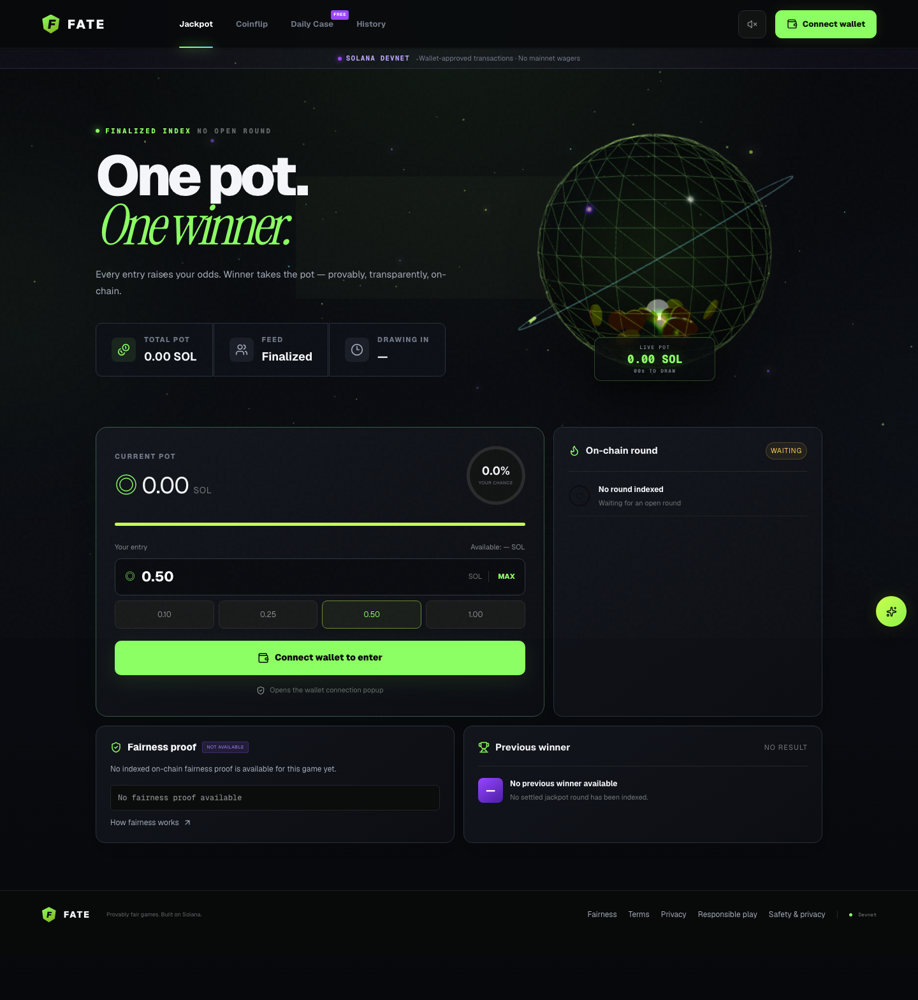

## Why FATE

FATE demonstrates how a polished gaming interface can be separated from the components that actually protect users and funds. The browser prepares transactions and presents finalized data; the Anchor program owns custody and game state; Switchboard commitments supply the randomness boundary; a finalized-only indexer builds the read model; deterministic server controls enforce wallet authentication, compliance, and play limits; and the AI assistant remains read-only and non-signing.

The project is deliberately broader than a frontend demo. It includes:

- three responsive, animated game experiences with real Wallet Standard discovery;
- an Anchor program with program-owned PDA vaults, settlement, refunds, pause controls, and timelocked configuration;
- direct-from-Solana fairness verification that does not trust the FATE API;
- wallet-bound sessions, transaction intent verification, reservations, and durable confirmation recovery;
- a tool-using OpenAI Copilot with privacy, cost, rate, ownership, and non-signing guardrails;
- responsible-play, eligibility, consent, and privacy-request workflows;
- replay-safe D1 projections, backups, restore validation, and background jobs;
- Prometheus metrics, Loki logs, Tempo traces, Grafana dashboards, and operational alerts;
- unit, contract, integration, accessibility, browser, load, security, and recovery tests.

## Status at a glance

| Area | Current state |
| --- | --- |
| Web application | Hosted and runnable locally; responsive desktop/mobile UI with graceful empty, offline, and reduced-motion states |
| Wallet integration | Real Wallet Standard discovery, signed authentication challenges, devnet validation, transaction approval, and confirmation recovery |
| Anchor program | Jackpot, Coinflip, and Daily Case state machines implemented with host tests and explicit release gates |
| Randomness | Switchboard On-Demand commit/reveal account boundary implemented; production provider deployment still requires validator-level acceptance and audit |
| AI Copilot | Optional server-side OpenAI integration with six allow-listed tools, streaming responses, audit records, feedback, rate limits, and budget controls |
| Data | D1/Drizzle schemas and migrations for product logs, chain projections, operations, authentication, compliance, privacy, AI, and background jobs |
| Observability | Local Prometheus, Grafana, Loki, Tempo, Alloy, alert rules, and deterministic fixture population |
| Mainnet | Intentionally disabled and fail-closed |

## Contents

- [Visual tour](#visual-tour)
- [Product features](#product-features)
- [Games](#games)
- [FATE Copilot](#fate-copilot)
- [Fairness and randomness](#fairness-and-randomness)
- [Wallets and transaction lifecycle](#wallets-and-transaction-lifecycle)
- [Safety, compliance, and privacy](#safety-compliance-and-privacy)
- [Architecture](#architecture)
- [Data and background processing](#data-and-background-processing)
- [Observability](#observability)
- [Quick start](#quick-start)
- [Configuration](#configuration)
- [API surface](#api-surface)
- [Testing](#testing)
- [Security model](#security-model)
- [Backup and recovery](#backup-and-recovery)
- [Deployment gates](#deployment-gates)
- [Repository map](#repository-map)

## Visual tour

The complete capture set and zero-error browser record are available in the [screenshot manifest](./artifacts/screenshots/2026-08-06T07-10-32-233Z/manifest.json).

### Desktop product experience

<table>
  <tr>
    <td width="50%" valign="top">
      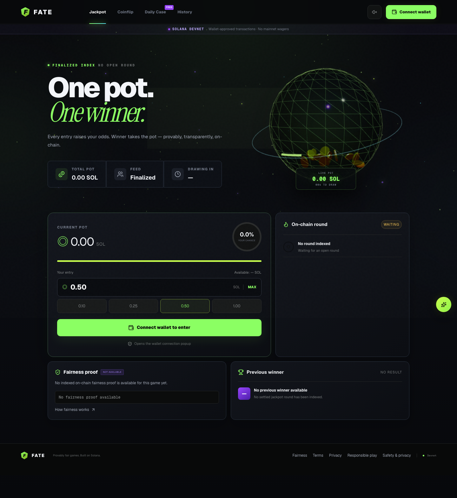<br>
      <sub><strong>Jackpot</strong> — live indexed round, SOL entry controls, calculated odds, previous result, and fairness evidence.</sub>
    </td>
    <td width="50%" valign="top">
      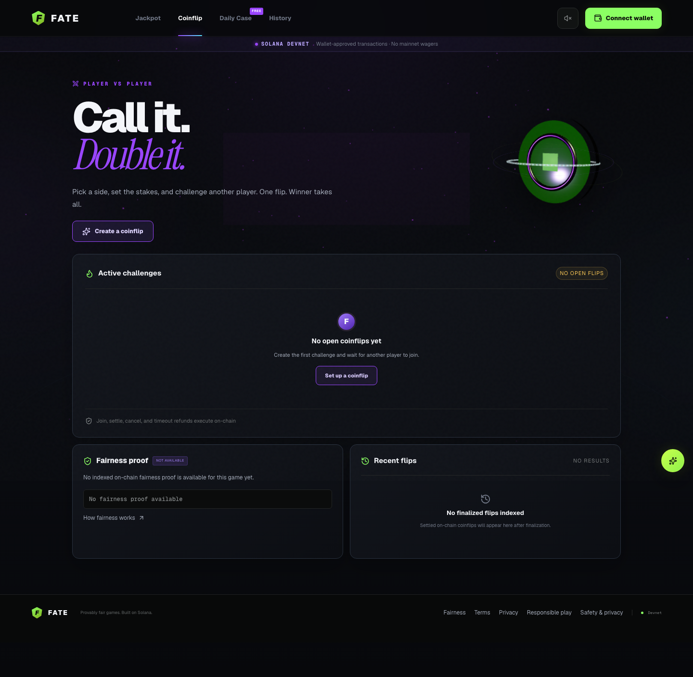<br>
      <sub><strong>Coinflip</strong> — create or join equal-stake player challenges, then settle, cancel, or recover on-chain.</sub>
    </td>
  </tr>
  <tr>
    <td width="50%" valign="top">
      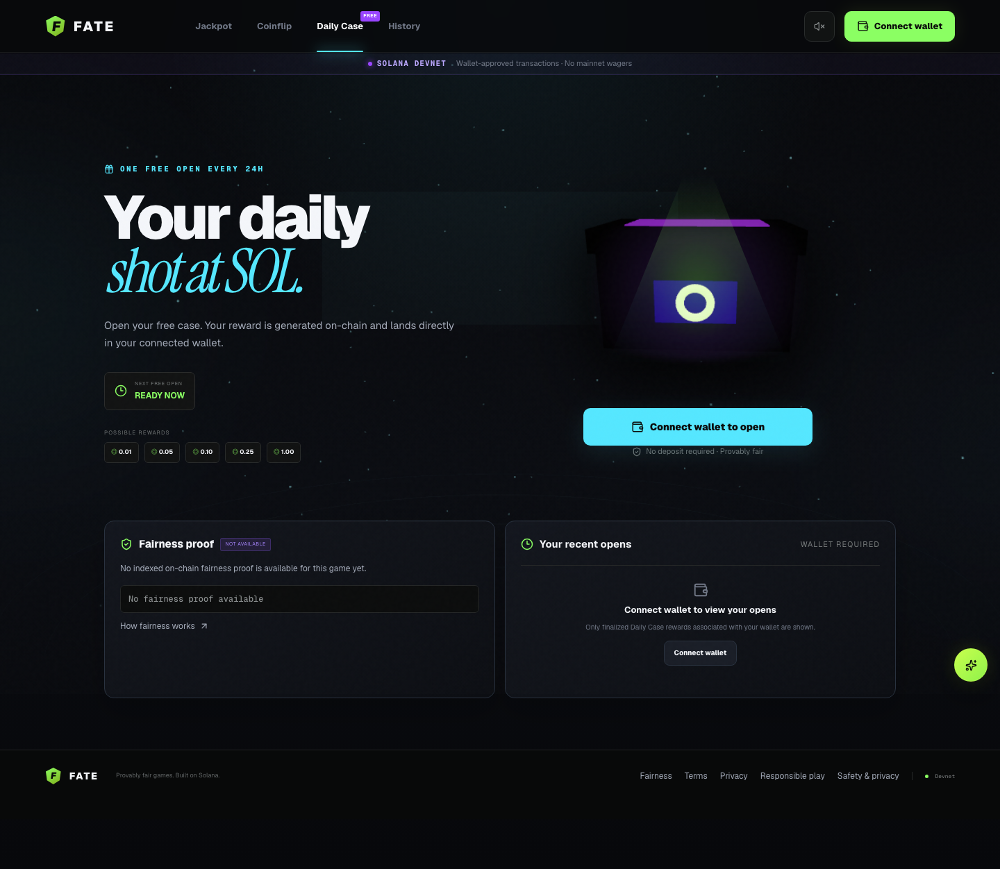<br>
      <sub><strong>Daily Case</strong> — one free open every 24 hours with deterministic reward tiers and no player deposit.</sub>
    </td>
    <td width="50%" valign="top">
      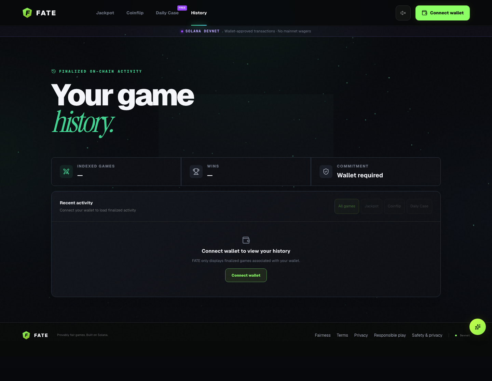<br>
      <sub><strong>History</strong> — wallet-scoped, finalized game activity with game filters and commitment status.</sub>
    </td>
  </tr>
  <tr>
    <td width="50%" valign="top">
      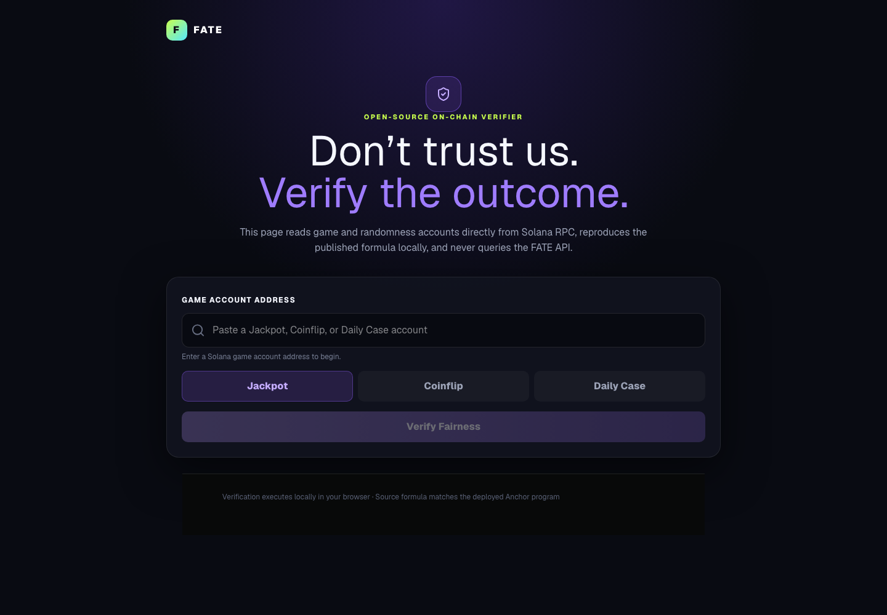<br>
      <sub><strong>Independent verifier</strong> — reads game and randomness accounts from Solana RPC and reproduces the result locally.</sub>
    </td>
    <td width="50%" valign="top">
      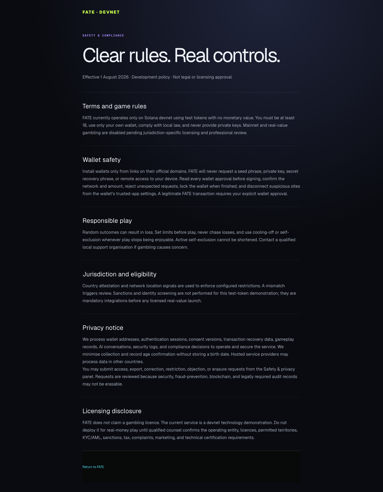<br>
      <sub><strong>Clear controls</strong> — terms, wallet safety, responsible play, privacy, jurisdiction, and licensing disclosures.</sub>
    </td>
  </tr>
</table>

<details>
<summary><strong>Open the complete mobile gallery</strong></summary>

The mobile layouts are purpose-built rather than scaled-down desktop pages: navigation collapses, controls remain touch-friendly, cards stack in reading order, dialogs trap focus correctly, and long legal content remains readable.

<table>
  <tr>
    <td width="25%" valign="top"><br><sub>Home</sub></td>
    <td width="25%" valign="top">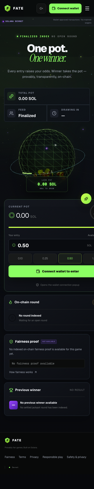<br><sub>Jackpot</sub></td>
    <td width="25%" valign="top">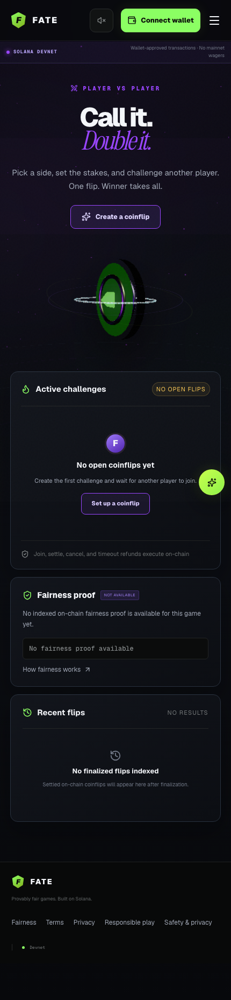<br><sub>Coinflip</sub></td>
    <td width="25%" valign="top">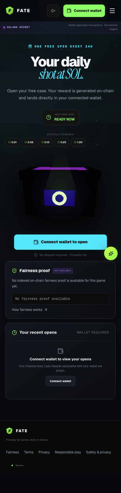<br><sub>Daily Case</sub></td>
  </tr>
  <tr>
    <td width="25%" valign="top">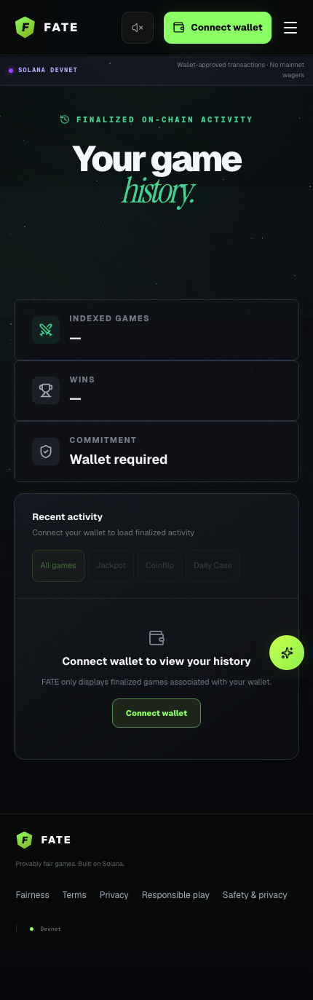<br><sub>History</sub></td>
    <td width="25%" valign="top">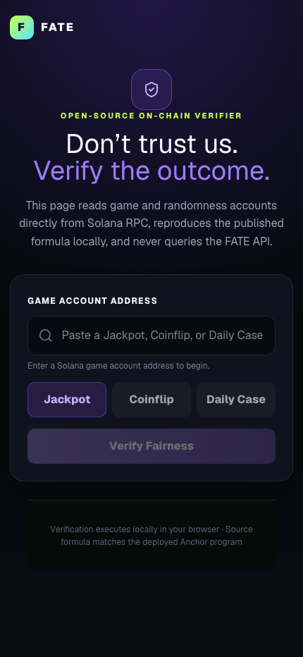<br><sub>Verifier</sub></td>
    <td width="25%" valign="top">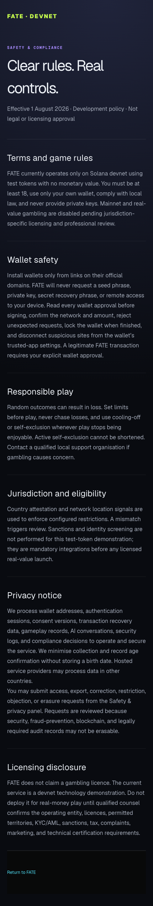<br><sub>Legal and safety</sub></td>
    <td width="25%"></td>
  </tr>
</table>

</details>

## Product features

### Player experience

- **One coherent game shell.** Jackpot, Coinflip, Daily Case, and History share URL-addressable routes, persistent navigation, wallet state, network status, sound preferences, compliance access, and the Copilot launcher.
- **Real wallet discovery.** The application discovers Wallet Standard-compatible providers instead of simulating a connection. Phantom, Backpack, and Solflare install/deep-link guidance is available when no provider is detected.
- **Mobile wallet handoff.** Mobile users receive provider deep links and QR-assisted flows; errors remain explicit and retryable.
- **Wallet-approved transactions.** FATE builds unsigned transactions, shows an awaiting-approval state, and never receives private keys or seed phrases.
- **Finalized read model.** Public game views use indexed, finalized Anchor events rather than optimistic browser-only state.
- **Three-dimensional presentation.** React Three Fiber scenes render the jackpot vault, coin, daily case, and spatial background.
- **Motion and sound controls.** Framer Motion transitions, lightweight Web Audio feedback, reduced-motion fallbacks, and a persistent mute toggle are built in.
- **Truthful empty states.** Missing rounds, unavailable proofs, absent wallets, stale data, and unconfigured services are presented as unavailable—not invented.
- **Responsive and accessible interaction.** Semantic landmarks, a skip link, keyboard dismissal, focus return, dialog focus trapping, live status text, accessible names, and automated axe/Playwright coverage are included.

### Platform capabilities

- wallet challenge/response authentication with hashed, HttpOnly session cookies;
- exact unsigned Solana message decoding before server authorization;
- deterministic compliance and responsible-play checks before transaction preparation;
- atomic wager reservations to prevent concurrent requests from exceeding limits;
- durable transaction operations from draft through finalization or visible failure;
- multiple RPC endpoints for confirmation recovery;
- replay-safe, slot-monotonic finalized event indexing;
- bounded product-log batching with IndexedDB persistence, retry, jitter, deduplication, and retention;
- local full-stack observability and production smoke/maintenance automation;
- versioned, checksummed backup and atomic restore planning.

## Games

| Game | Player flow | Outcome | Recovery behavior |
| --- | --- | --- | --- |
| **Jackpot** | Enter an open round with SOL; the UI calculates the current chance from the proposed entry and indexed pot | Verified randomness is mapped across cumulative lamport ranges, so selection is proportional to deposited lamports | After a ten-minute randomness timeout, refunds can be enabled and each entrant claims the recorded deposit once |
| **Coinflip** | A creator selects Heads or Tails and escrows a wager; a different wallet joins with the equal wager on the opposite side | Verified randomness selects one of the two players; the program pays the net pot and configured fee | An unmatched game can be cancelled after expiry; a joined game refunds both players if randomness times out |
| **Daily Case** | A wallet requests one free case per 24-hour cooldown; the player never deposits a wager | The first verified random byte maps to one of five fixed reward tiers funded by the Daily vault | A stale pending request can be cleared after the randomness timeout so the player account is not permanently blocked |

### Jackpot

- deterministic round, vault, and entry PDAs;
- up to 128 recorded entries per round;
- checked wager and pot arithmetic;
- fee-aware `MAX` calculation that reserves the network fee and safety balance;
- maximum entry bounded by wallet balance, program limits, and daily/weekly responsible-play remaining amounts;
- weighted winner selection over exact lamport ranges;
- explicit `open → randomness requested → settled/refunding` lifecycle;
- permissionless timeout activation and wallet-claimed refunds;
- account closure only after terminal state and zero remaining refund liability.

### Coinflip

- equal wagers and two distinct wallets enforced on-chain;
- creator chooses a side; joiner receives the opposite side;
- fresh Switchboard commitment bound when the second player joins;
- provider reveal and permissionless settlement composed in the same transaction;
- winner and treasury accounts verified by the program;
- creator cancellation for expired unmatched games;
- symmetric timeout refund for joined games;
- rent-bearing accounts reclaimable only after the vault is clear.

### Daily Case

- one player PDA per wallet and one program Daily reward vault;
- no player deposit;
- 86,400-second cooldown enforced using the Solana clock;
- deterministic reward schedule matching the public verifier:

| Random byte | Probability | Reward |
| --- | ---: | ---: |
| `0–1` | 0.78125% | 1.00 SOL |
| `2–11` | 3.90625% | 0.25 SOL |
| `12–51` | 15.625% | 0.10 SOL |
| `52–151` | 39.0625% | 0.05 SOL |
| `152–255` | 40.625% | 0.01 SOL |

The vault must be sufficiently funded for the selected reward. Idle or completed player accounts can be closed; an account waiting for randomness cannot.

## FATE Copilot

The floating FATE Copilot is a streaming, tool-using assistant built on the OpenAI Responses API. It is designed to explain and inspect the platform—not to act as a wallet, oracle, or autonomous gambler.

### What Copilot can do

| Tool | Capability | Access boundary |
| --- | --- | --- |
| `explain_game` | Explain deterministic game rules and timeout recovery | Public, grounded in program design |
| `get_wallet_activity` | Summarize up to 25 indexed entries and their total lamports | Requires an authenticated session for the exact requested wallet |
| `verify_fairness` | Return stored settlement and randomness evidence for a game address | Read-only indexed evidence |
| `diagnose_transaction` | Compare a tracked wallet operation with current Solana RPC signature status | Requires ownership of the tracked operation |
| `check_responsible_limits` | Evaluate a proposed amount against deterministic limits, cooldown, and self-exclusion | Requires the authenticated wallet |
| `draft_game_action` | Produce an expiring, unsigned devnet action draft | Never signs or submits; simulation and explicit wallet approval remain mandatory |

### Copilot experience

- server-sent event streaming with metadata, deltas, completion, cancellation, and retry states;
- suggested prompts for fairness, timeout recovery, verification, and wallet activity;
- wallet-bound and anonymous conversation ownership;
- conversation reset when the wallet changes;
- thumbs-up/down feedback protected by a message-specific capability token;
- a dedicated limits tab for deterministic daily and weekly AI-draft limits;
- explicit unavailable states when no provider key is configured.

### AI safety and governance

- The system prompt forbids requesting secrets, signing, choosing outcomes, promising profit, chasing losses, or presenting inference as verified evidence.
- Prompt validation rejects likely secrets and common instruction-override attempts before a provider request.
- Provider credentials remain server-side and are never exposed through a public environment variable.
- OpenAI requests use `store: false` and a bounded, privacy-preserving safety identifier.
- Tool schemas are strict and allow-listed; a response can execute at most three tool rounds.
- Wallet-specific tools compare the requested wallet with the authenticated session.
- Conversation history is owner-scoped and bounded to the most recent records used by the request.
- Per-wallet request and token budgets use durable rate-limit buckets.
- A configurable monthly cost circuit breaker stops new provider work when the estimated budget is reached.
- Tool inputs, results, outcome, precise duration, model usage, token categories, user feedback, and traces are auditable.
- Errors redact provider credentials and return stable public codes.

### AI observability

The dedicated dashboard separates request rate, success, provider latency, model token usage, estimated cost, monthly budget, conversations, tool outcomes, tool duration, feedback, structured logs, and LLM/agent traces.

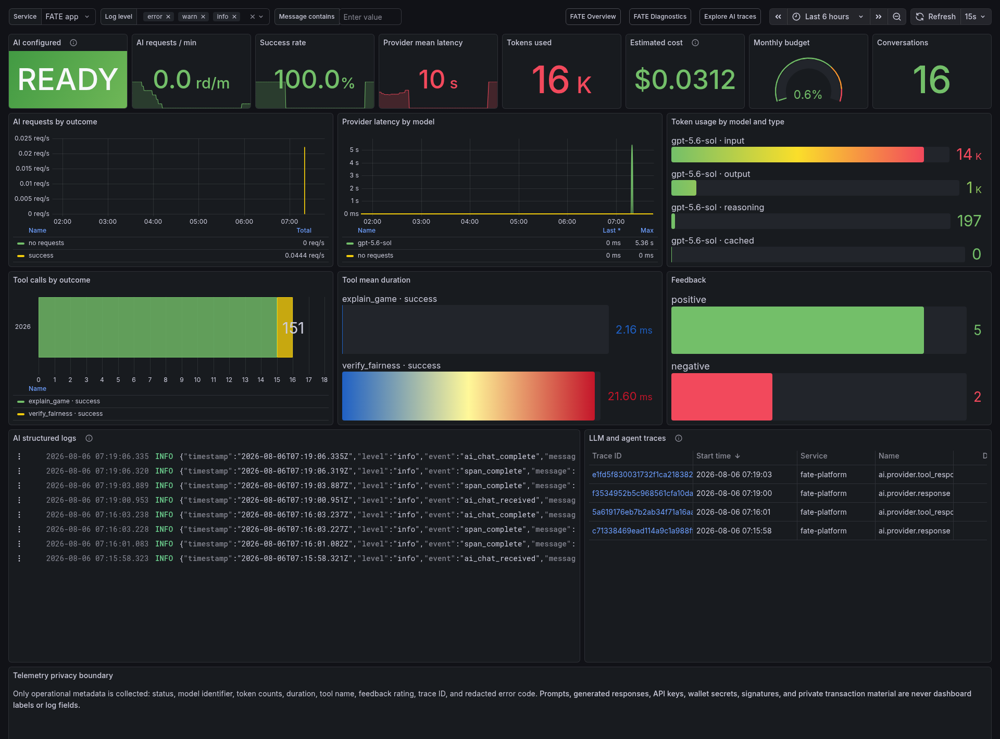

Enable Copilot locally with a server-only key:

```dotenv
OPENAI_API_KEY=your-server-side-key
OPENAI_MODEL=your-approved-model
AI_MAX_REQUESTS_PER_WALLET_DAY=50
AI_MAX_TOKENS_PER_WALLET_DAY=100000
AI_MONTHLY_BUDGET_USD=5
```

## Fairness and randomness

FATE uses Switchboard On-Demand commit/reveal accounts as a provider boundary. Every paid or reward-bearing game binds a provider-owned randomness account before reveal and stores the seed slot. A `RandomnessReceipt` PDA prevents commitment reuse and records the wallet that funded its rent.

At commitment, the program verifies:

- the configured provider program owns the account;
- the account discriminator and configured queue match;
- the value is still unrevealed;
- the commitment is fresh with `seed_slot == clock.slot - 1`;
- the same commitment has not already been consumed.

At settlement, the program requires the same account and seed slot, obtains the revealed value, calculates the result deterministically, records the evidence on-chain, emits it in settlement events, and closes the receipt back to its original rent payer. Timeout recovery closes only a stale commitment and returns paid wagers or clears a free Daily request.

### Independent browser verifier

The `/verify` page deliberately bypasses the FATE application API. Given a Jackpot, Coinflip, or Daily Case account, it:

1. reads the game account directly from the configured Solana RPC;
2. reads and validates the committed randomness account;
3. checks ownership, queue binding, seed/reveal slots, and stored bytes;
4. reproduces the same weighted winner, coin side, or Daily reward formula locally;
5. compares the reproduced result with the value recorded on-chain.

This creates an independently inspectable path from finalized Solana data to the displayed outcome.

## Wallets and transaction lifecycle

### Wallet authentication

1. The browser requests a short-lived challenge containing the wallet, origin, network, nonce, and expiry.
2. The wallet signs the challenge through Wallet Standard.
3. The server verifies the exact message and signature.
4. A hashed, HttpOnly, same-site session cookie binds later account-specific requests to that wallet.
5. Wallet changes invalidate the old client session context; the application never silently reuses authentication for another account.

### Transaction preparation and recovery

```mermaid
flowchart LR
    UI[Game UI] --> BUILD[Build unsigned Solana transaction]
    BUILD --> API[POST /api/transactions]
    API --> DECODE[Decode exact message and fee payer]
    DECODE --> POLICY[Compliance + wager + rate checks]
    POLICY --> RESERVE[Atomic spend reservation]
    RESERVE --> WALLET[Wallet simulation and approval]
    WALLET --> SUBMIT[Signature submitted]
    SUBMIT --> QUEUE[Durable confirmation job]
    QUEUE --> RPC[Multi-provider Solana RPC]
    RPC --> FINAL[Finalized / failed / expired]
    FINAL --> INDEX[Finalized event index]
```

The server does not trust client-declared amounts. It decodes the unsigned Solana message, verifies the fee payer, program instruction, game/action pairing, and exact lamport movement, then stores a durable operation. Confirmation jobs use leases, bounded retries, exponential backoff, block-height/expiry checks, message-hash verification, dead-letter visibility, and RPC failover. Refreshing the browser recovers the pending operation display without asking the user to sign again.

## Safety, compliance, and privacy

FATE treats these controls as deterministic application policy—not model judgment.

### Eligibility and consent

- devnet-only age and jurisdiction attestation;
- versioned acceptance of terms, privacy notice, and game risk;
- ISO alpha-2 country allow/block configuration;
- network/declaration mismatch routed to manual review;
- immutable compliance decisions recorded in an audit log;
- server policy that fails closed for mainnet.

### Responsible play

- daily and weekly lamport limits;
- 24-hour and seven-day cooldown actions;
- 180-day self-exclusion;
- immediate enforcement during transaction preparation and AI draft generation;
- active self-exclusion and cooldown periods cannot be shortened;
- maximum wager calculation respects remaining responsible-play capacity.

### Privacy rights

Authenticated wallets can submit access, export, and erasure requests. Requests follow a durable lifecycle:

```text
received → in_review → approved → processing → fulfilled / partially_fulfilled / failed
```

- Duplicate active requests are deduplicated.
- Review deadlines and processing status remain visible to the wallet.
- Export artifacts are wallet-owner-only, checksummed JSON with a configurable expiry (seven days by default).
- Erasure removes eligible off-chain records while truthfully reporting immutable Solana history, minimum security evidence, and active responsible-play restrictions that must remain.
- Active transaction recovery blocks unsafe erasure and schedules a retry.
- Administrative review and processing use protected automation routes and write compliance audit events.

## Architecture

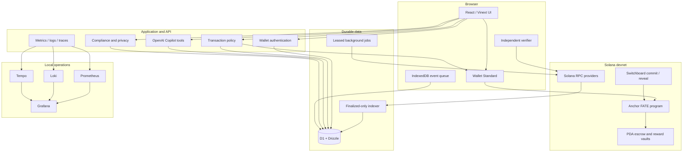

### Trust boundaries

- **Browser:** may prepare and request transactions, but never owns treasury, oracle, pause, configuration, or upgrade keys.
- **Application server:** authenticates wallets, validates exact transaction intent, enforces policy, and performs read-only AI/tool orchestration.
- **Anchor program:** owns escrow and reward state, enforces transitions, calculates outcomes, and controls settlement/refunds.
- **Randomness provider:** supplies verifiable commitments and reveals but cannot bypass FATE account/queue/freshness checks.
- **Indexer:** turns finalized events into rebuildable query projections; it cannot choose or change outcomes.
- **Observability:** receives bounded operational metadata. Prompts, responses, secrets, signatures, and private transaction material are excluded from dashboard labels.

### Dependency direction

```text
Browser: app routes → features/components → environment-neutral lib contracts
Server:  app API routes → server services → db
Chain:   client transaction builders ↔ independently released Anchor program
```

Features and presentation components do not import database or server internals. The web application, APIs, and D1 migrations release together; the custody program has a separate audit and deployment gate.

## Data and background processing

### Durable schema

| Table group | Purpose |
| --- | --- |
| `event_logs` | Minimized product telemetry with bounded metadata and retention |
| `chain_events` | Replay-safe canonical Anchor events keyed by transaction position |
| `games`, `game_entries` | Rebuildable, public query projections for game and wallet views |
| `transaction_operations` | Authoritative wallet operation lifecycle, intent hash, retries, expiry, and spend reservation |
| `wallet_auth_challenges`, `wallet_sessions` | Expiring signed challenges and hashed wallet sessions |
| `rate_limit_buckets` | Atomic durable rate limiting |
| `background_jobs` | Leased confirmation, maintenance, and privacy processing work |
| `indexer_checkpoints` | Finalized cursor progress, health, and backfill state |
| `ai_conversations`, `ai_messages` | Owner-scoped Copilot history and response metadata |
| `ai_tool_calls`, `ai_usage`, `ai_feedback` | Tool audit, token/cost inputs, precise duration, and user ratings |
| `responsible_play_limits` | Wallet limits, cooldowns, and self-exclusion |
| `compliance_profiles`, `compliance_audit_events` | Eligibility, jurisdiction, consent versions, and durable decisions |
| `privacy_requests`, `privacy_request_artifacts` | Review workflow, status, checksum, and expiring exports |

### Finalized Solana indexer

- reads only `finalized` program transactions;
- decodes known Anchor events with lossless lamport values;
- writes each raw chain event and its query projections in one D1 batch;
- uses transaction-position uniqueness for replay safety;
- claims cursors to prevent overlapping workers;
- retains the last durable checkpoint after a failed request;
- performs live sync and bounded historical backfill;
- refuses older slots that would overwrite newer projection state;
- keeps public `GET /api/indexer/games` requests side-effect free.

### Product logging

The browser queues events in IndexedDB, flushes bounded batches asynchronously, retries transient failures with exponential backoff and jitter, deduplicates by UUID, and retains logs for 90 days. The policy excludes secrets, signatures, raw user agents, seed material, and IP-derived fields.

## Observability

The local Docker Compose stack runs the application and its monitoring plane with persistent volumes and localhost-only published ports.

| Component | Purpose | Default URL |
| --- | --- | --- |
| Application | Vinext/Cloudflare runtime with persistent local D1 | `http://localhost:3100` |
| Prometheus | Metrics, recording rules, and alerts | `http://localhost:9090` |
| Grafana | Provisioned overview, diagnostics, and AI dashboards | `http://localhost:3001` |
| Loki | Structured application/container logs | `http://localhost:3101` |
| Tempo | OpenTelemetry traces and TraceQL search | `http://localhost:3200` |
| Alloy | Docker log discovery and normalization | Internal only |
| Image renderer | Authenticated server-side dashboard screenshots | Internal only |

### Dashboards

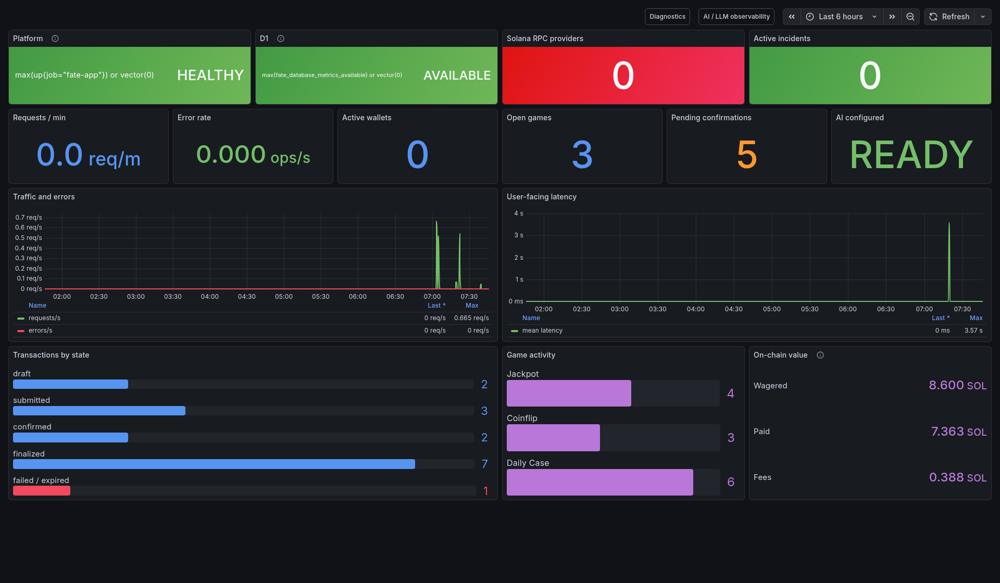

<details>
<summary><strong>Open the detailed diagnostics dashboard</strong></summary>

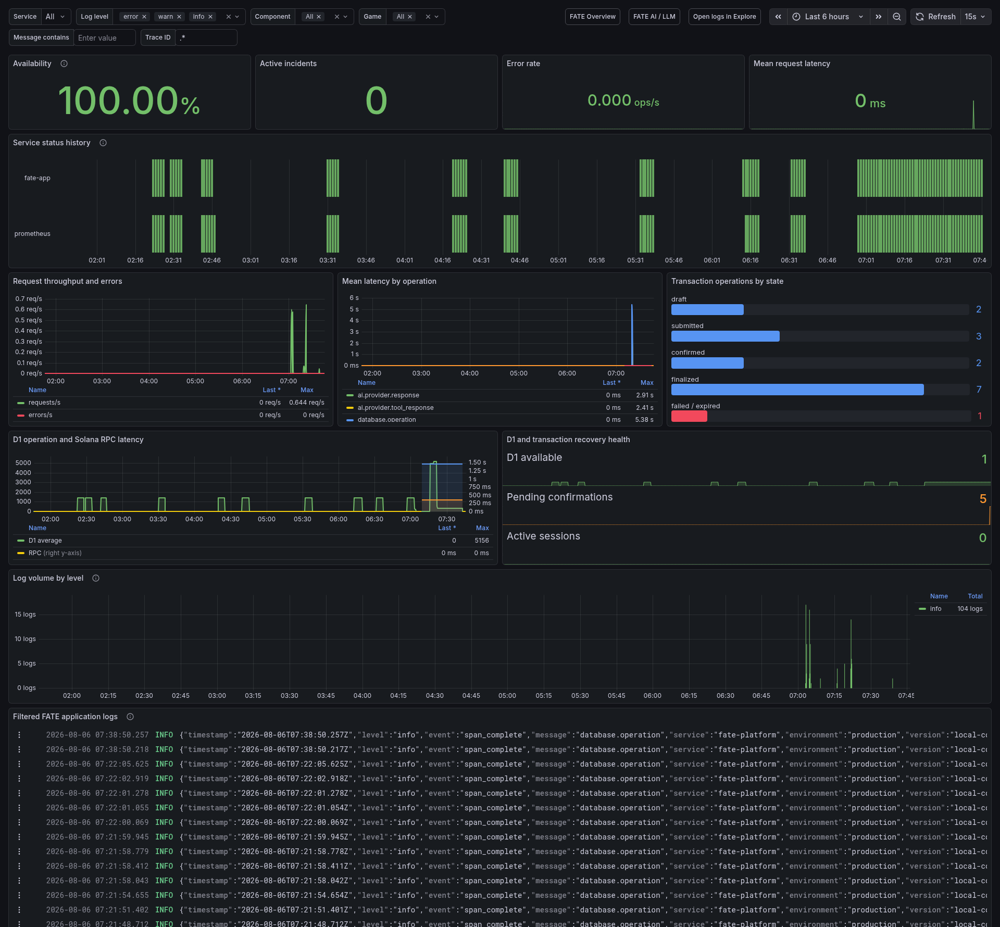

</details>

The dashboards cover service/database/RPC availability, incidents, request and error rates, user-facing latency, wallet activity, open games, pending confirmations, transaction states, SOL wager/payout/fees, D1/RPC latency, logs, AI requests, tokens, cost, budget, tool calls, feedback, and traces.

Alert rules include application/database outages, D1 latency, error-rate elevation, AI provider latency, rate-limit spikes, transaction backlog/dead letters/stalls, Solana RPC availability/latency, and missing telemetry. Alerts carry severity, impact, and runbook metadata.

### Local dashboard fixtures

The local stack enables an authenticated, local-compose-only fixture endpoint. It is idempotent and returns `404` unless both local runtime guards are present.

```bash
set -a
source local.env
set +a

curl --fail --request POST \
  --header "Authorization: Bearer ${AUTOMATION_TOKEN}" \
  http://127.0.0.1:3100/api/internal/observability-fixture
```

The fixture populates representative transaction states, game activity, on-chain values, Copilot tool timings, and positive/negative feedback for dashboard verification.

## Quick start

### Prerequisites

- Node.js `22.13+`
- npm
- a Wallet Standard-compatible Solana wallet for interactive transactions
- Docker Desktop or a compatible Docker Engine for the full local platform
- Rust `1.89+` for the resolved Anchor/Solana host test dependencies
- Solana CLI, Anchor CLI, and a local validator only for full transaction-level program testing

### Web development

```bash
git clone https://github.com/Sapir-pirski/fate-solana-games.git
cd fate-solana-games
npm ci
cp .env.example .env.local
npm run dev
```

Open `http://localhost:3000`. Keep `NEXT_PUBLIC_SOLANA_CLUSTER=devnet`, configure a valid devnet program/RPC combination, and switch the connected wallet to devnet. A missing wallet produces an installation flow rather than a fake account.

### Complete local platform

```bash
cp local.env.example local.env
```

Replace every `replace-with-...` value in `local.env`, then start and verify the stack:

```bash
./scripts/local-platform.sh up
./scripts/local-platform.sh health
./scripts/local-platform.sh status
```

Useful lifecycle commands:

```bash
./scripts/local-platform.sh logs
./scripts/local-platform.sh down
```

The stack uses persistent Docker volumes, binds published ports only to `127.0.0.1`, stays on devnet, and never imports production credentials or game state.

### Capture the application and dashboards

With the local stack healthy and `local.env` configured:

```bash
node scripts/capture-live-screenshots.mjs
```

The capture script records every hosted page at desktop and mobile sizes, then renders all three authenticated Grafana dashboards and writes a machine-readable manifest.

## Configuration

Copy `.env.example` to `.env.local` for web development or `local.env.example` to `local.env` for Docker Compose. Never place a private key, seed phrase, production wallet secret, or provider key in a `NEXT_PUBLIC_*` variable.

### Solana and randomness

| Variable | Purpose |
| --- | --- |
| `NEXT_PUBLIC_SOLANA_CLUSTER` | Must remain `devnet` until launch gates are complete |
| `NEXT_PUBLIC_SOLANA_RPC_URL` | Browser RPC used for account reads and transaction preparation |
| `NEXT_PUBLIC_SOLANA_RPC_URLS` | Optional comma-separated confirmation recovery providers |
| `SOLANA_RPC_URL` | Server-side indexer, confirmation, and diagnostic RPC |
| `NEXT_PUBLIC_FATE_PROGRAM_ID` / `FATE_PROGRAM_ID` | Public/client and server representations of the same verified program address |
| `NEXT_PUBLIC_SWITCHBOARD_PROGRAM_ID` | Expected provider program |
| `NEXT_PUBLIC_SWITCHBOARD_QUEUE` | Deployment-selected provider queue |
| `NEXT_PUBLIC_COINFLIP_RANDOMNESS_ENDPOINT` | Returns a fresh committed account for each join |
| `NEXT_PUBLIC_DAILY_RANDOMNESS_ENDPOINT` | Returns a fresh committed account for each Daily open |

The static randomness-account variables exist only for a one-request local/devnet acceptance fixture; they are not a production allocation strategy.

### AI

| Variable | Purpose |
| --- | --- |
| `OPENAI_API_KEY` | Server-only provider credential; blank disables Copilot cleanly |
| `OPENAI_MODEL` | Approved Responses API model identifier |
| `AI_MAX_REQUESTS_PER_WALLET_DAY` | Durable daily request ceiling |
| `AI_MAX_TOKENS_PER_WALLET_DAY` | Durable daily input/output token ceiling |
| `AI_PROVIDER_TIMEOUT_MS` | Bounded provider timeout |
| `AI_MONTHLY_BUDGET_USD` | Service-wide monthly circuit breaker |
| `AI_*_USD_PER_MILLION_TOKENS` | Cost estimates used by observability and the circuit breaker |

### Compliance, privacy, and automation

| Variable | Purpose |
| --- | --- |
| `COMPLIANCE_ALLOWED_COUNTRIES` | Optional comma-separated ISO alpha-2 allow list |
| `COMPLIANCE_BLOCKED_COUNTRIES` | Comma-separated ISO alpha-2 deny list |
| `PRIVACY_REQUEST_DEADLINE_DAYS` | Review deadline, 30 days by default |
| `PRIVACY_EXPORT_TTL_SECONDS` | Export download expiry, seven days by default |
| `INDEXER_AUTH_TOKEN` | Protected indexer/operations credential |
| `AUTOMATION_TOKEN` | Maintenance, privacy administration, backup, and restore credential |
| `RESTORE_MAX_BYTES` / `RESTORE_MAX_ROWS` | Restore input safety bounds |

### Telemetry

| Variable | Purpose |
| --- | --- |
| `OTEL_SERVICE_NAME` | Service identity used in logs and traces |
| `OTEL_EXPORTER_OTLP_ENDPOINT` | OTLP/HTTP base URL; blank disables trace export without affecting gameplay |
| `APP_REVISION` | Build/revision label exposed in health and telemetry |

### Local observability stack

These variables are read from `local.env` when running the complete Docker Compose platform:

| Variable | Purpose |
| --- | --- |
| `FATE_LOCAL_PORT` | Host port for the local application; defaults to `3100` |
| `GRAFANA_ADMIN_USER` / `GRAFANA_ADMIN_PASSWORD` | Local Grafana credentials used by dashboard access and screenshot rendering |
| `GRAFANA_PORT` | Host port for Grafana; defaults to `3001` |
| `PROMETHEUS_PORT` | Host port for Prometheus; defaults to `9090` |
| `LOKI_PORT` | Host port for Loki; defaults to `3101` |
| `TEMPO_PORT` | Host port for Tempo; defaults to `3200` |

## API surface

| Route | Methods | Purpose |
| --- | --- | --- |
| `/api/health` | `GET` | Service, network, revision, and D1 readiness |
| `/api/metrics` | `GET` | Prometheus text exposition with stable zero-state categories |
| `/api/logs` | `POST` | Bounded, deduplicated product-event ingestion |
| `/api/indexer/games` | `GET` | Side-effect-free finalized game projections |
| `/api/auth/challenge` | `POST` | Create expiring wallet authentication challenges |
| `/api/auth/verify` | `POST` | Verify wallet signature and issue a session |
| `/api/auth/session` | `GET`, `DELETE` | Inspect or end the authenticated wallet session |
| `/api/transactions` | `GET`, `POST`, `PATCH` | Prepare, recover, and update wallet-owned operations |
| `/api/ai/status` | `GET` | Report whether Copilot is configured |
| `/api/ai/chat` | `POST` | Stream grounded Copilot responses and bounded tool rounds |
| `/api/ai/feedback` | `POST` | Store message-bound helpful/not-helpful feedback |
| `/api/ai/limits` | `GET`, `POST` | Read/write deterministic limits used by AI drafts |
| `/api/ai/ops` | `POST` | Return a non-signing operations plan |
| `/api/compliance/profile` | `GET`, `POST` | Eligibility, jurisdiction, and consent state |
| `/api/compliance/responsible-play` | `GET`, `POST` | Limits, cooldown, and self-exclusion |
| `/api/compliance/privacy` | `GET`, `POST` | Wallet-owned request status, submission, and export download |
| `/api/internal/indexer` | `POST` | Authenticated finalized sync and historical backfill |
| `/api/internal/maintenance` | `POST` | Confirmation, privacy, retention, and scheduled maintenance |
| `/api/internal/privacy` | `GET`, `POST` | Protected review queue and decisions |
| `/api/internal/backup` | `GET` | Versioned, checksummed JSON export |
| `/api/internal/restore` | `POST` | Guarded validation and atomic replacement workflow |
| `/api/internal/observability-fixture` | `POST` | Authenticated, local-compose-only dashboard data fixture |

## Testing

### Standard validation

```bash
npm run lint
npm test
npm run test:unit
cargo fmt --all -- --check
cargo test --workspace --locked
```

`npm test` performs a production build before the policy, route, security-gate, observability, wallet-recovery, fairness, and Solana safety regression tests.

### Test matrix

| Command | Coverage |
| --- | --- |
| `npm test` | Production build plus Node-based policy and structural regressions |
| `npm run test:unit` | AI policy/usage, backup, privacy jobs, Solana clients/indexer, confirmation, intent, reservations, and wallet-chain logic |
| `npm run test:integration` | Local D1 migration and route integration |
| `npm run test:contract` | Browser-driven API contracts |
| `npm run test:browser` | Desktop/mobile navigation, dialogs, wallet states, and pending-operation recovery |
| `npm run test:accessibility` | Automated axe checks and keyboard-accessible workflows |
| `npm run test:load` | Read-only k6 workload against the local platform |
| `npm run test:bundle` | Production build and bundle budgets |
| `npm run test:production` | Hosted application smoke checks |
| `npm run test:devnet` | Explicitly opted-in devnet smoke checks |
| `npm run test:acceptance` | Hosted app, RPC, executable program, configuration PDA, and evidence gates |
| `npm run test:failure` | Opt-in container restart and recovery behavior |

Failure and live-chain suites require explicit opt-in because they mutate local infrastructure or depend on external devnet state:

```bash
FATE_RUN_FAILURE_TESTS=1 npm run test:failure
FATE_RUN_DEVNET_TESTS=1 npm run test:devnet
```

### CI and supply-chain checks

GitHub Actions run web builds, linting, Node/unit/integration/browser/contract/accessibility tests, bundle budgets, Rust formatting/tests/clippy, npm and Cargo audits, CodeQL, OSV scanning, SBOM generation, scheduled smoke/maintenance, daily backups, and manually triggered devnet acceptance evidence.

## Security model

### On-chain controls

- deterministic game, entry, receipt, and vault PDAs;
- program-owned custody rather than an application wallet;
- checked arithmetic for wagers, pots, fees, payouts, and refunds;
- minimum/maximum wager and fee bounds;
- single-settlement state transitions;
- verified winner, treasury, provider, queue, and randomness accounts;
- ten-minute permissionless timeout recovery;
- pause authority that can stop new exposure without disabling settlement/refunds;
- separate configuration and pause authorities;
- two-step, 24-hour delayed authority rotations;
- 24-hour propose/apply timelock for treasury, randomness, fee, and wager configuration;
- terminal account closure only after funds and refund liabilities are clear;
- compatibility with separately controlled Squads vault PDAs;
- a distinct program-upgrade authority required by the deployment runbook.

### Application controls

- same-origin enforcement on sensitive browser requests;
- wallet-signed authentication and hashed session material;
- exact transaction-message validation rather than trusting client metadata;
- rate limits and bounded request sizes;
- server-only automation and provider credentials;
- idempotent mutations and leased background work;
- minimized telemetry with secret/unbounded-identifier scrubbing;
- fail-closed mainnet, compliance, and live-acceptance policy;
- versioned migrations, backups, checksums, and restore bounds.

Read the project security documents before changing custody, randomness, authentication, or operations:

- [Security policy](./SECURITY.md)
- [Threat model](./docs/THREAT_MODEL.md)
- [Internal security audit](./docs/SECURITY_AUDIT.md)
- [Independent audit scope](./docs/EXTERNAL_AUDIT_SCOPE.md)
- [Authority and multisig runbook](./docs/MULTISIG_RUNBOOK.md)
- [Dependency security](./DEPENDENCY_SECURITY.md)

Internal review and passing tests are not independent assurance. Report vulnerabilities privately to the repository owner and never include seed phrases, private keys, exploitable live details, or wallet signatures in a public issue.

## Backup and recovery

Production automation exports the application-owned D1 data daily as a private workflow artifact. The `fate-d1-json-v2` format contains the schema manifest, applied migrations, row counts, table rows, and a SHA-256 checksum.

Validate a backup without changing data:

```bash
BASE_URL=https://fate-solana-games.sapirp.chatgpt.site \
AUTOMATION_TOKEN=... \
npm run db:restore -- fate-d1-backup.json
```

An actual replacement additionally requires `--apply` and `RESTORE_CONFIRM_CHECKSUM` set to the checksum printed by the successful dry run. Rows are loaded into isolated staging tables, validated against schema/row limits/checksum, and swapped in one atomic D1 batch. A failed staging operation leaves current tables untouched.

Object storage is intentionally absent because the application has no user-file workload.

## Deployment gates

Before any mainnet or real-value consideration:

1. generate a dedicated program keypair and reproducible build evidence;
2. deploy a clean devnet program/account set compatible with the current receipt layout;
3. pin and verify the intended Switchboard deployment and queue;
4. run local-validator and devnet adversarial transaction tests for every instruction and timeout path;
5. prove long-history index replay, confirmation recovery, backup, and restore behavior;
6. complete economic fuzzing, load testing, and incident exercises;
7. commission an independent Solana program audit and remediate every finding;
8. complete legal, licensing, KYC/AML, sanctions, privacy, marketing, and jurisdiction review;
9. separate deployer, upgrade, configuration, pause, treasury, and automation roles under audited multisigs;
10. pass the committed [devnet acceptance matrix](./docs/DEVNET_ACCEPTANCE.md) with immutable evidence;
11. perform a controlled launch review with production RPC, monitoring, alert ownership, backups, and rollback/response runbooks.

The acceptance command intentionally fails closed when the live program, configuration PDA, hosted application, or required evidence is missing. Local test success must not be reported as completed devnet acceptance.

## Repository map

```text
app/                         Routes, UI shell, API handlers, Copilot, compliance
components/three/            React Three Fiber scenes and WebGL infrastructure
components/ui/               Reusable presentation primitives
features/                    Product features and browser orchestration
lib/                         Shared policy, clients, validation, telemetry, backup
server/services/             Authentication, compliance, indexing, jobs, recovery
db/                          Canonical Drizzle schema and D1 connection
drizzle/                     Versioned SQL migrations
programs/fate-games/          Anchor custody and settlement program
deploy/local/                Prometheus, Grafana, Loki, Tempo, Alloy configuration
scripts/                     Local platform, smoke, acceptance, backup, screenshots
tests/                       Policy, unit, integration, browser, load, failure tests
docs/                        Architecture, threat model, audit, runbooks, acceptance
.github/workflows/            CI, security, operations, and acceptance automation
artifacts/screenshots/        Desktop, mobile, and Grafana evidence with manifest
```

## Development notes

- Run `npm run db:generate` after changing `db/schema.ts`, review the SQL, and apply the generated migration through the target hosting environment before enabling new writes.
- Keep public routes side-effect free. Scheduled or mutating operational work belongs behind authenticated internal routes.
- Do not import server or database modules into browser components.
- Do not add new AI tools without strict schemas, authorization rules, bounded output, audit storage, and non-signing behavior.
- Do not change game economics, randomness, custody, authority, or close/refund rules without updating the program tests, verifier, threat model, and audit scope together.
- Preserve truthful unavailable states; do not replace missing finalized data with demo values in public production paths.

## Contributing

Small, focused changes are easiest to review. Before opening a pull request:

1. explain the user or security problem being solved;
2. include tests for behavior and failure paths;
3. run the relevant web and Rust validation commands;
4. update documentation, environment examples, dashboards, and migrations when contracts change;
5. attach screenshots for visible desktop/mobile changes;
6. call out custody, randomness, privacy, compliance, AI, or migration risk explicitly.

## License

FATE is available under the [MIT License](./LICENSE).

<p align="center">
  <strong>Build for verification. Keep custody on-chain. Never ask for the keys.</strong>
</p>
